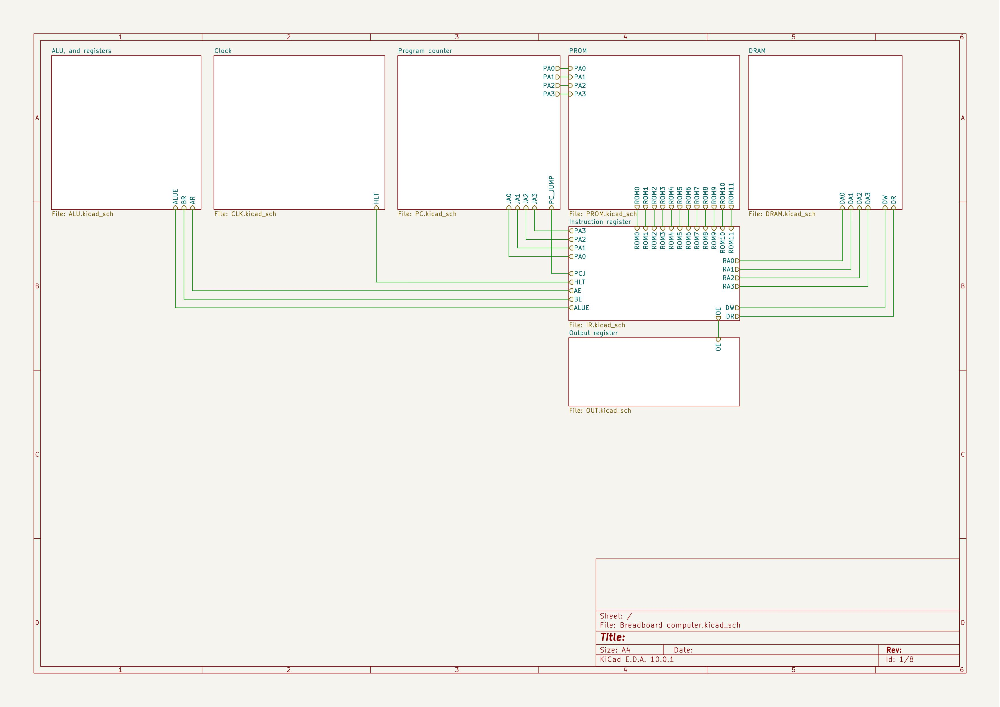
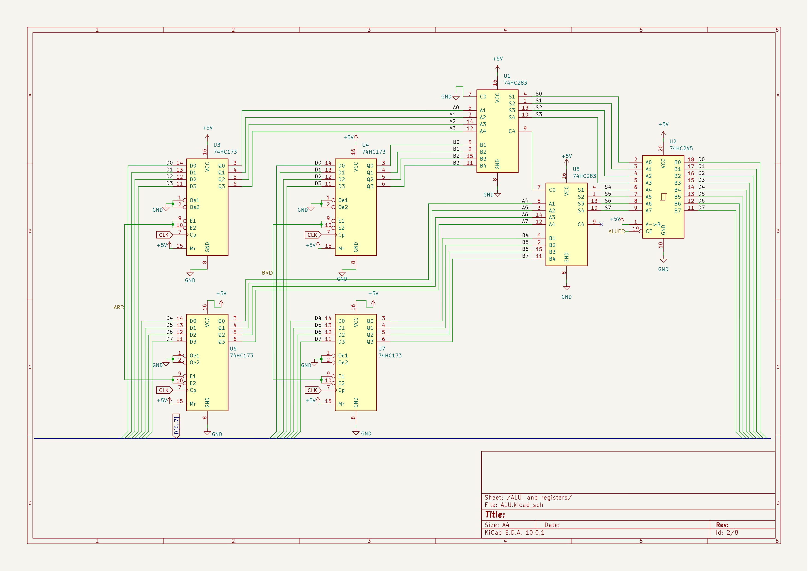
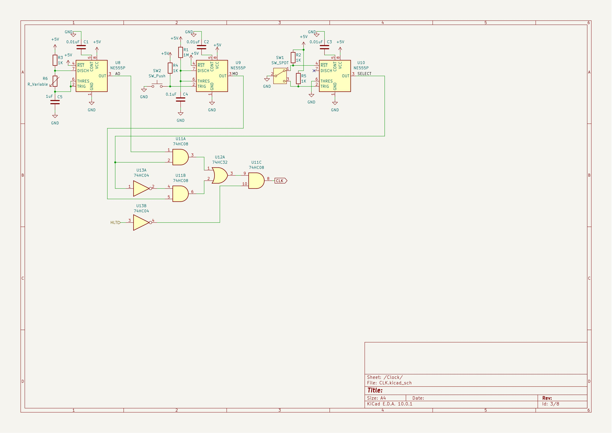
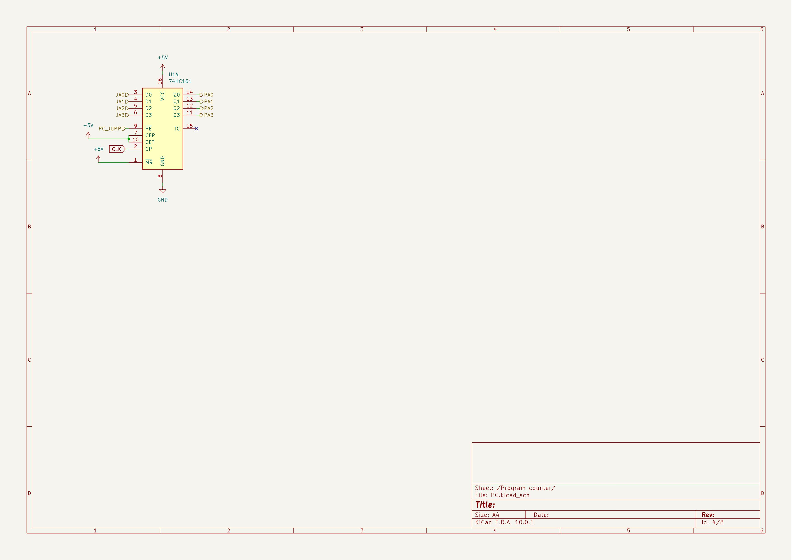
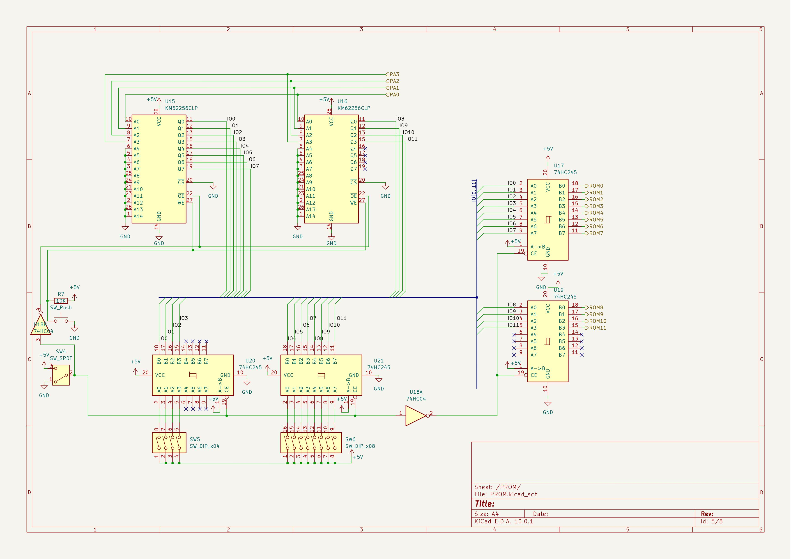
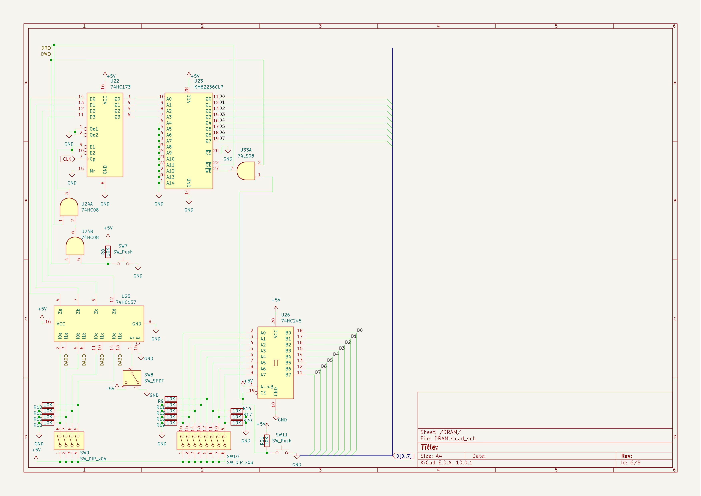
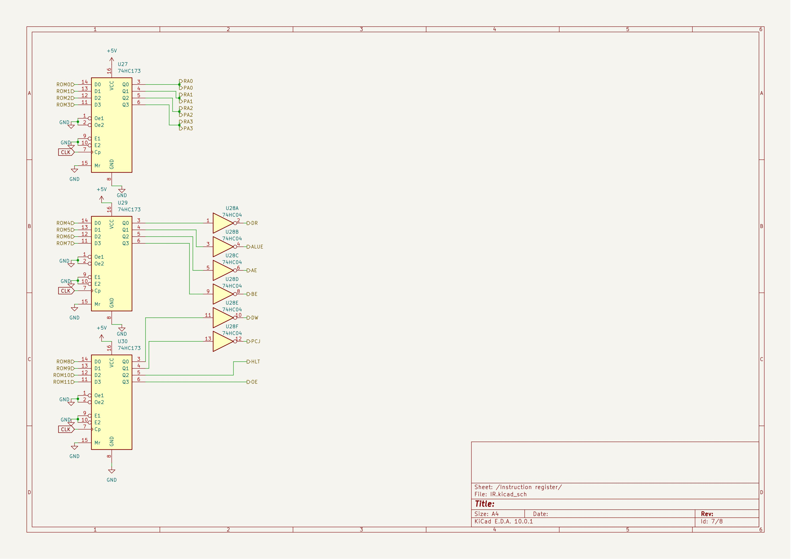
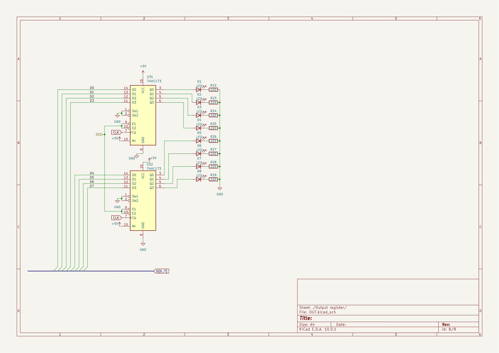

# Breadboard-computer
This is my project for week 5 of hack club halflife. This week, I designed a custom 8 bit computer. It uses a fully custom architecture, runs custom code, basically everything designed by e. It uses parts from the 74HC line, all in breadboard compatible DIP packages. This project has been one of my dream projects for more than a year now, but I never thought I could do it, but now I decided that I will go through with it no matter what, so here we are now.

## Architecture
This computer uses 2 registers connected straight to the ALU, which is a simple binary adder. It uses an 8 bit bus, which is where the registers read from, and the ALU writes to. It uses a bistable clock, so you can choose between using button presses for manual clock tics, or a clock that has a variable frequency from  a potentiometer making constant tics. The clock increments a program counter, which gives the address straight to the PROM, in this computer I use a harvard architecture, which just means I have a seperate PROM for storing commands, and a DRAM for storing data. I choose this architecture type because it seemed simpler to me than having both be stored at the same place. The PROM uses 12 bits for an output, that is because I wanted to be able to control everything from those bits, so I don't have to do a seperate unit that transforms smaller commands into actual control signals. The DRAM is what's storing the actual data for stuff like variables, it is a more standard 8 bit module, reading from, and writing to the bus. The instruction register is connected straight to the outputs of the PROM, transforming those into control signals for each component, and also storing the current instruction. The output registers only job is to take the outtput on the BUS, and display it using LEDs

## Credit
I want to credit Ben Eater, since I used his explanations to understand the workings and usage of some components, specifically the bus logic, and the clock. Other than these parts, everything else is designed fully by me, and I'm also using a totally different architecture.

## Assembly
To assemble this project, you will first need to connect the breadboards. Based on my calculations 9 breadboards should fit comfortably. To create the main data bus, You should take off the power rails from the sides of a few of the  breadboards, snapping them together. The parts on the breadboard should be layed out in this way:

For the breadboards, lay out the components in the middle over the crest, and connect them according to the schematics. One thing that is not on the schematic, is that for the ICs I recommend having a 100nF capacitor connected between the power pins and ground, for smoother power. For the power input you can either use a proper benchtop power supply, for a more stable 5V power output, or a simple USB power supply for more simplicity.

## Usage and programming
To program the computer, first switch the clock into monostable (button controlled) mode, and turn it on. After that set the PROM's mode to writing by having the switch connected to GND, and then enter one command into it using the DIP switches. After that to save the command press the button connected to the /WE pins, and press the clock button to continue to the next command. After that cycle through the clock to reset the program counter to 0, and set the PROM's mode to reading by connecting the switch to 5V. After that if you cycle through the PROM's addresses, you should be able to run the code. For programming you will be able to use 12 bits. The first 4 are address pins, with the other 8 controlling the components. For a command first use the address pins to set up an address used by the DRAM or the proogram counter. After that the next 8 pins are usable like this:
1. Read the data in the DRAM at the set address, and write that to the bus
2. Output the ALU's result onto the bus (sum of the numbers in registers A and B)
3. Read the data on the bus and save it to register A
4. Read the data on the bus and save it to register B
5. Read the data on the bus and save it to the DRAM at the set address
6. Jump to the set address in the program counter
7. Halt excecution(stop the clock)
8. Read the data on the bus and save it to the output register, and display it using the LEDs. Active low.

Important: Do not have the first and second pins high at the same time, since they will both try to output onto the BUS at the same time, which will have unexpected consequences!

Example code:  
`0000 10100001` Put the data stored in the DRAM at address 0, and save it to the A register  
`0001 10010001` Put the data stored in the DRAM at address 1, and save it to the b register  
`0010 01001000` Put the sum of the numbers in register A and B onto the BUS, save it to the DRAM at address 3, and output it.  
`0000 00000100` Jump back to the first command, so restart the program, and create a loop.

## Images
Main connections:  
  
ALU+registers:  
  
Clock:  
  
Program counter:  
  
PROM:  
  
DRAM:  

Instruction register:  

Output register:  

## BOM
| Item                     | Qty | Supplier   | Cost/item | Total Cost | link                                                  |
|--------------------------|-----|------------|-----------|------------|-------------------------------------------------------|
| 74HC173                  | 10  | LCSC       | $0.35     | $3.50      | https://www.lcsc.com/product-detail/C22466319.html    |
| 74HC245                  | 6   | LCSC       | $0.82     | $4.92      | https://www.lcsc.com/product-detail/C2899.html        |
| 74HC04                   | 5   | LCSC       | $0.12     | $0.60      | https://www.lcsc.com/product-detail/C54540195.html    |
| 62256 RAM                | 3   | Aliexpress | $2.53     | $7.59      | https://www.aliexpress.com/item/1005009405170628.html |
| NE555                    | 5   | LCSC       | $0.25     | $1.25      | https://www.lcsc.com/product-detail/C46749.html       |
| 74HC08                   | 5   | LCSC       | $0.12     | $0.60      | https://www.lcsc.com/product-detail/C18723499.html    |
| 74HC283                  | 5   | LCSC       | $0.36     | $1.80      | https://www.lcsc.com/product-detail/C24833608.html    |
| 74HC157                  | 5   | LCSC       | $0.30     | $1.50      | https://www.lcsc.com/product-detail/C22436657.html    |
| 74HC161                  | 1   | LCSC       | $1.20     | $1.20      | https://www.lcsc.com/product-detail/C1523311.html     |
| 74HC32                   | 5   | LCSC       | $0.15     | $0.75      | https://www.lcsc.com/product-detail/C41427253.html    |
| 830 point breadboards    | 9   | Aliexpress | $1.12     | $10.08     | https://www.aliexpress.com/item/1005008642599597.html |
| Push buttons             | 20  | LCSC       | $0.02     | $0.40      | https://www.lcsc.com/product-detail/C42416242.html    |
| 4 pin dip switches       | 5   | LCSC       | $0.20     | $1.00      | https://www.lcsc.com/product-detail/C5299505.html     |
| 8 pin dip switches       | 2   | LCSC       | $0.46     | $0.92      | https://www.lcsc.com/product-detail/C458084.html      |
| Select switch            | 10  | LCSC       | $0.05     | $0.50      | https://www.lcsc.com/product-detail/C698216.html      |
| Potentiometer            | 1   | Aliexpress | $1.24     | $1.24      | https://www.aliexpress.com/item/1005004773968041.html |
| Resistors                | 1   | Aliexpress | $5.11     | $5.11      | https://www.aliexpress.com/item/1005011772534173.html |
| LEDs                     | 1   | Aliexpress | $1.77     | $1.77      | https://www.aliexpress.com/item/1005005708510866.html |
| 1uF capacitor            | 1   | LCSC       | $0.60     | $0.60      | https://www.lcsc.com/product-detail/C1882850.html     |
| 100nF capacitors         | 30  | LCSC       | $0.23     | $6.90      | https://www.lcsc.com/product-detail/C2169797.html     |
| 10nF capacitor           | 5   | LCSC       | $0.39     | $1.95      | https://www.lcsc.com/product-detail/C1620112.html     |
| Estimated total shipping | 1   |            |           | $0.00      |                                                       |
